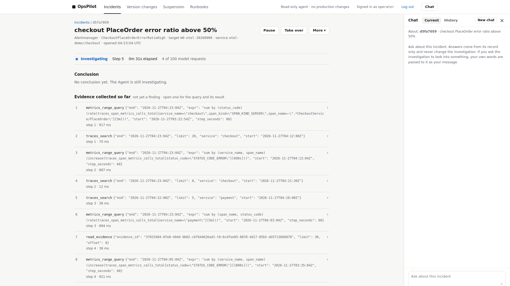
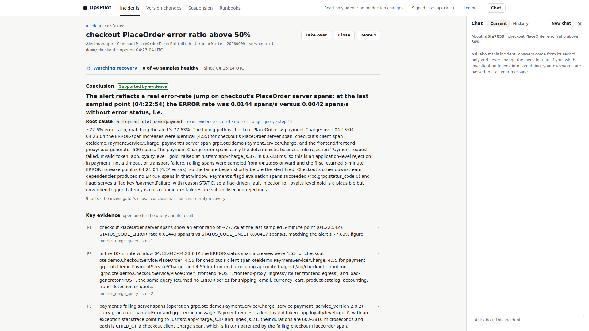
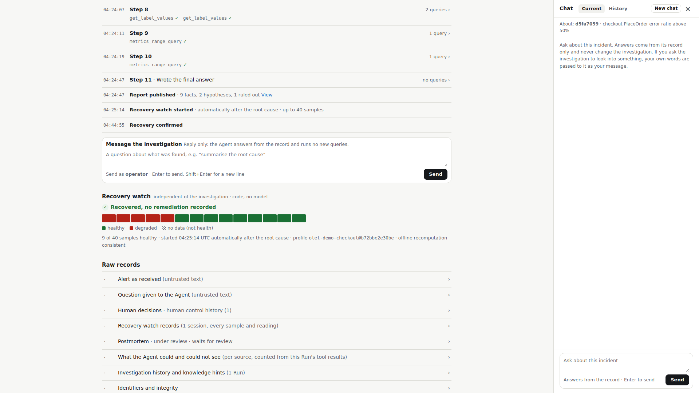
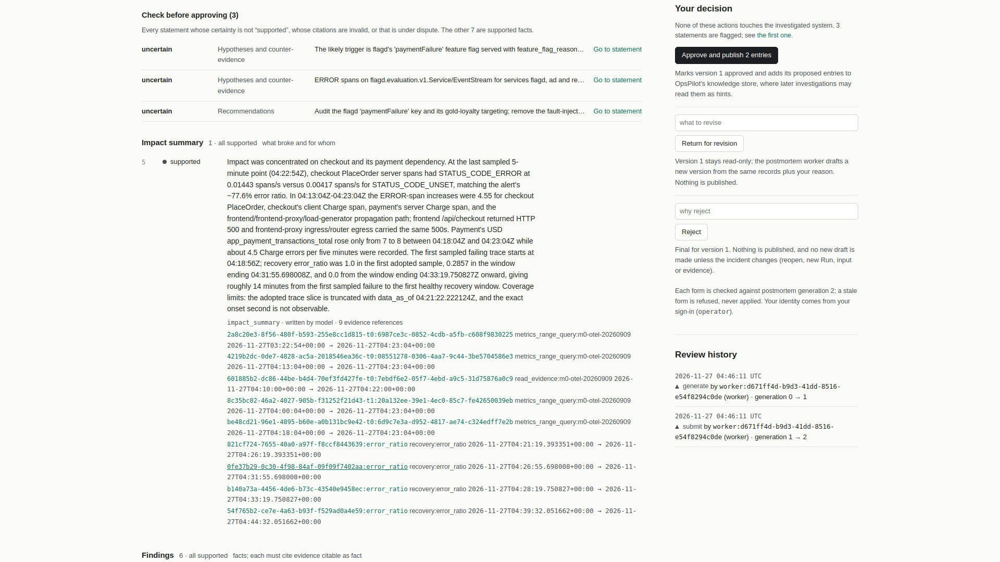

# OpsPilot — Read-only Operations Investigator

English | [简体中文](README.zh-CN.md)

OpsPilot is a continuously running agent for incident and post-release investigation. It reads telemetry and never executes production changes or remediation. Recovery observation (read-only) can be authorized automatically after a qualifying conclusion; everything else stays under human control.

Internal process documents are written in Chinese. Where this README and the Chinese contract documents ([SPEC.md](SPEC.md), [PRODUCT-CONSTRAINTS.md](PRODUCT-CONSTRAINTS.md), the [C3 technical design](docs/design/technical-proposal-2026-09-07.md), task records) disagree, the Chinese contract documents are authoritative.

## What it does

- **Investigates.** An Alertmanager alert opens an incident. When the alert matches a configured target, an investigation Run starts; otherwise the incident is handed to a human. The model gathers evidence through read-only, target-scoped tools, keeps competing hypotheses, and publishes a report that separates facts, hypotheses and gaps. When evidence is missing it says so, or hands the incident to a human, instead of guessing.
- **Works with a human.** In the workbench an operator reads the report, asks follow-up questions (each opens a new Run), pauses investigation globally or per target, and closes or reopens incidents. Human control always takes precedence over the agent.
- **Observes recovery independently.** After a human has handled an incident, or automatically after a qualifying conclusion, a separate Observer process with its own read-only Prometheus account samples service health and records whether the service recovered. It never performs a recovery action.
- **Drafts reviewed postmortems.** The worker drafts a postmortem from the incident record; it becomes knowledge for later investigations only after a human approves it in the workbench.
- **Watches releases.** A version-change event starts an observation window; a delayed regression becomes an incident. OpsPilot never approves, blocks or executes a release.

Data sources, all read-only: Prometheus and Jaeger; with the `otel-demo-ext` tool profile also Kubernetes objects, Pod logs and Pod/node usage, Elasticsearch/OpenSearch, Loki, VictoriaLogs, SQL databases (PostgreSQL, MySQL/MariaDB, ClickHouse, SQL Server), MongoDB, Redis/Valkey, Kafka, Argo CD applications and Helm releases.

What it will not do is fixed in [PRODUCT-CONSTRAINTS.md](PRODUCT-CONSTRAINTS.md): no production writes, no release gates, no execution of recovery steps.

### One incident in the workbench

Screenshots from one run on 2026-11-27 in the lab (OpenTelemetry Demo on kind, synthetic traffic, the `paymentFailure` fault injected by the lab script; [evidence](docs/evidence/workbench-live-2026-11-27/README.md)). The alert fired at 04:23:04 UTC, the report was published at 04:24:47 with the root cause `Deployment otel-demo/payment`, the Observer confirmed recovery at 04:44:55, and the postmortem draft was approved at 04:48:39. That approval was clicked by the recording script under the `operator` account, not by a person reviewing the draft.

| Investigating | Report |
|---|---|
|  |  |
| **Recovery watch** | **Postmortem review** |
|  |  |

## Status

Milestone M3 (effect and delivery acceptance) has reached its completion line (all steps of F8, F9 and F14, plus F1 steps 1–4); F1 is not marked as passing because its step 5 is not achieved. This is a portfolio project built to production engineering standards; it has **never run in production**.

- 9 of 11 features pass all their acceptance steps in [feature_list.json](feature_list.json) (F2, F6, F7, F8, F9, F11, F12, F13, F14). F1 is open. F3 passed on 2026-10-25 and was set back to open on 2026-11-16: under a later report prompt, one of two reviewed Runs wrote a hypothesis as fact in its summary ([#664](https://github.com/kevinWangSheng/production-ops-agent/issues/664)). F8 (operability) and F9 (delivery) passed on lab evidence only, not production.
- All M3 acceptance evidence was measured in a kind lab running the OpenTelemetry Demo: synthetic load-generator traffic, injected faults, a real model (DeepSeek). That includes a [same-condition comparison with HolmesGPT](docs/results/f1-same-condition-comparison-2026-11.md) (F1 step 5, calibrated judging, is not achieved), a [72-hour lab soak](docs/evidence/m3-soak-2026-11-07/README.md), and an install, full incident flow, worker kill and pinned-image upgrade/rollback on a freshly reinstalled host ([step 1](docs/evidence/f9-final-clean-host-2026-11-11/README.md), [step 3](docs/evidence/f9-steps-2-4-2026-11-10/README.md), [steps 2 and 4](docs/evidence/f9-final2-2026-11-11/README.md); the limits are listed in [limitations](docs/portfolio/limitations.md)).
- Releases are tagged and published to GHCR by the release workflow. The latest is `v0.1.1` (2026-11-10); the soak and the first clean-host runs used `v0.1.0`, and the [final clean-host run](docs/evidence/f9-final-clean-host-2026-11-11/README.md) (2026-11-11) switched between the pinned `v0.1.0` and `v0.1.1` digests. The `v0.1.0` digest is `ghcr.io/kevinwangsheng/opspilot@sha256:228df9f72e6964e1d7d7110365d3b59330d7fc93ebd89e62b70631de6c7aaabd`.

### Benchmark results (2026-11)

Integration runs on rented hosts (kind clusters; replayed offline snapshots for ITBench-Lite and Cloud-OpsBench) with a real model (DeepSeek `deepseek-flash`) and judge Z.ai `glm-5.3-flashx`, which differs from the upstream benchmarks' judges; Cloud-OpsBench is scored by its own deterministic evaluator, with no judge. Every trial counts; a trial without a report scores 0. None of this is production evidence.

| Benchmark | Run | OpsPilot | Reference |
|---|---|---|---|
| HolmesGPT public evals, same questions, same model, same judge | 53 questions × 3 trials, full run 2026-11-21 | 133/159 | HolmesGPT 150/159, same run |
| same, after fixes [#772](https://github.com/kevinWangSheng/production-ops-agent/pull/772), [#775](https://github.com/kevinWangSheng/production-ops-agent/pull/775), [#776](https://github.com/kevinWangSheng/production-ops-agent/pull/776) | targeted OpsPilot-only rerun 2026-11-22 | 145/159, composed (see below) | HolmesGPT not rerun |
| SREGym Lite, diagnosis | 17 problems × 3 trials, 2026-11-21 | 43/51 | — |
| ITBench-Lite SRE, offline snapshots | 35 scenarios × 3 trials, 2026-11-18 | 82/105 official root-cause pass@1 | — |
| HolmesGPT public evals, same model, same judge | 57 questions × 3 trials (53 above plus 4 new), full run 2026-11-23 ([evidence](docs/evidence/rental-2026-11-23/full/run.md)) | 163/171; the same 53 questions 151/159 | HolmesGPT 162/171: the 4 new questions run this time (12/12), the other 53 carried over from 2026-11-21 (150/159) |
| SREGym Lite, diagnosis | 17 problems × 3 trials, 2026-11-23 ([evidence](docs/evidence/rental-2026-11-23/full/sregym/run.md)) | 38/51 | — |
| ITBench SRE, live (fault injected into a fresh deployment, investigation starts from the alert) | 24 scenarios × 1 trial, 2026-11-26 ([evidence](docs/evidence/itbench-live-full-1125/run.md)) | 14/24 official root-cause pass; 14/22 without the 2 injection failures; 14/19 with an official score | — |
| Cloud-OpsBench (LLM4Ops; snapshot-based K8s root-cause analysis, 754 cases) | stratified 100-case subset, 1 run, 2026-11-26 ([task record](docs/tasks/2026-11-26-cloudopsbench.md), Chinese) | JRA 0.96 (full-set weighted estimate 0.962); Boutique 0.973, TrainTicket 0.923 | the benchmark's bundled ReAct agent on the same model: JRA 0.89 (0.898); Boutique 0.932, TrainTicket 0.769 |

- HolmesGPT evals by group (full run → after fixes, vs HolmesGPT): databases 21/21 vs 16/21 (HolmesGPT's 5 misses are pytest errors or skips with no answer; whether the upstream harness is at fault is not confirmed); Elasticsearch and multi-cluster 72/90 → 82/90 vs 86/90; runbooks/skills 10/18 → 12/18 vs 18/18; Loki and VictoriaLogs 27/27 vs 27/27; task list 3/3 vs 3/3. HolmesGPT ran its upstream default configuration, which includes tools OpsPilot leaves out under its read-only constraint.
- The 145/159 is not a single full run. Questions rerun 3 times (12 Elasticsearch, 6 runbook, and one Loki question given 3 extra trials) take the rerun score; questions rerun once keep their full-run score; question 235 uses its isolated 3-trial rerun (3/3), because in the batch rerun a parallel question's namespace leaked into it (with that contaminated 1/3 the total is 143).
- ITBench-Lite: the score is the official evaluator's `root_cause_entity_f1 == 1` per trial, with the judge above instead of the official example's. Under OpsPilot's own deterministic entity match (`det_pass`) the same 105 trials score 22/105. Conclusions skew to `partial`: 22 `supported`, 83 `partial`. There is no HolmesGPT run on this set.
- Known gaps found in the 2026-11-21 run: the lookback window was fixed at 24 hours by design, the tracked cause of two HolmesGPT questions at 0/3, 185 and 280 ([#779](https://github.com/kevinWangSheng/production-ops-agent/issues/779)); there is no input for standing per-target operator instructions, which question 162 (0/3) relies on ([#780](https://github.com/kevinWangSheng/production-ops-agent/issues/780)); SREGym problem p12 (Valkey) scores 0/3 because its target has no read-only account to give the Redis/Valkey tools ([#773](https://github.com/kevinWangSheng/production-ops-agent/issues/773)).
- 2026-11-23 run (frozen commit `51257e79`, after the 30-day lookback and the report-contract fixes): the HolmesGPT side reran only the 4 new questions; its other 53 results are the 2026-11-21 ones, not a fresh run. Questions 185 and 280 score 3/3 with the 30-day lookback; 162 stays at 0/3 (no standing operator instructions, [#780](https://github.com/kevinWangSheng/production-ops-agent/issues/780)). The judge ran out of balance mid-run and 70 trials were judged afterwards from the saved answers, same judge and rubric.
- SREGym 38/51 against the earlier 43/51: every failed trial submitted a complete report. A swing rerun of the three problems that dropped, at the same commit on 2026-11-24, scored 8/9, the same as the earlier run, so the drop is read as run-to-run variance (an inference from 6 trials per problem; [#831](https://github.com/kevinWangSheng/production-ops-agent/issues/831), [swing rerun](docs/evidence/rental-2026-11-24/swing/run.md)). p12 is still 0/3.
- ITBench live: self-hosted and self-run, not a leaderboard entry. The score is the official evaluator's `root_cause_entity_f1 == 1`, judged by the judge above. One trial per scenario, so single results can swing. Of the 5 unscored scenarios, 2 failed fault injection upstream, 2 raised no entry alert, and 1 completed but the official evaluator returned no score after 3 tries; all 5 count 0 in the 24. The evaluation side patches a namespace label, which departs from the upstream default.
- Cloud-OpsBench: one run of each line (the control at temperature 0); run-to-run variance was not measured. OpsPilot keeps its default cap of 100 model requests, while the control runs the benchmark's 20 iterations; on 19 cases the control's output was truncated by the benchmark's default `max_tokens` 4096. Failed cases count 0 in the denominator, unlike the benchmark's own `summarize`, which averages only cases with an answer file. Frozen summaries: [OpsPilot](docs/evidence/cloudopsbench-r20261126/opspilot/summary.json), [control](docs/evidence/cloudopsbench-r20261126/control/summary.json).
- Evidence: [HolmesGPT full run](docs/evidence/rental-2026-11-20/full/run.md) (per-group `compare-*.md`), [targeted rerun](docs/evidence/rental-2026-11-20/rerun-2026-11-22/run.md) and its [per-question comparison](docs/evidence/rental-2026-11-20/rerun-2026-11-22/compare.md), [SREGym scores](docs/evidence/rental-2026-11-20/full/sregym/sregym-lite-full/scores.json), [ITBench-Lite run](docs/evidence/itbench-lite-sre-lite-full-r3/run.md); summary in the [tool expansion record](docs/tasks/2026-11-12-tool-expansion.md) (Chinese).

For a guided tour, start at the [portfolio walkthrough](docs/portfolio/README.md); what the evidence does not show is in [limitations](docs/portfolio/limitations.md). Work order: [ROADMAP.md](ROADMAP.md).

## Install with Docker Compose

The install runs on the control side: one Linux host running PostgreSQL, the web workbench, the worker (investigator) and the Observer, each as its own container from one product image. The workbench is published on `127.0.0.1` only; PostgreSQL publishes no port.

You need a Linux host with Docker Engine and the Compose v2 plugin, `bash`, `python3` (standard library only, used to hash the generated credentials) and this repository checked out. Run everything as a dedicated **non-root** user that can use Docker; `install.sh` refuses to run as root. macOS with colima works for development only.

On an image that only allows root logins, create that user as root and continue from its login shell; it needs no sudo (to run the pinned lab on the same host, follow [the lab section](#the-opentelemetry-demo-lab-on-the-same-host) instead, which also installs Docker):

```sh
adduser --disabled-password --gecos "" opspilot
usermod -aG docker opspilot
su - opspilot
```

### 1. Install

```sh
git clone https://github.com/kevinWangSheng/production-ops-agent.git
cd production-ops-agent
deploy/compose/install.sh install
```

This builds the image `opspilot:local` from the checkout, generates every password and token once, migrates the database, creates the four runtime database logins and starts the web workbench. Secrets go to `${XDG_CONFIG_HOME:-$HOME/.config}/opspilot` (outside the repository, mode 0600; set `OPSPILOT_SECRETS_DIR` to choose another directory). The steps below refer to that directory as `$SECRETS` and to the workbench port as `$PORT`:

```sh
SECRETS="${OPSPILOT_SECRETS_DIR:-${XDG_CONFIG_HOME:-$HOME/.config}/opspilot}"
PORT="${OPSPILOT_WEB_HOST_PORT:-18080}"
```

If you installed with a custom `OPSPILOT_SECRETS_DIR`, export it again in this shell, or set `SECRETS` to the directory `install.sh install` printed (its last lines say where `ui_password` and the Alertmanager token are). Likewise, if you installed with a custom `OPSPILOT_WEB_HOST_PORT`, export it again or read it from `$SECRETS/install.env`, which remembers the port (the installer also prints the workbench URL).

Re-running `install` is safe: it never regenerates a password. No secret is printed.

### 2. Log in to the workbench

```sh
cat "$SECRETS/ui_password"
```

Open `http://127.0.0.1:$PORT` and log in as user `operator` with that password. From another machine, use an SSH tunnel with the same local port (the allowed origins follow `OPSPILOT_WEB_HOST_PORT`):

```sh
ssh -L "$PORT:127.0.0.1:$PORT" <user>@<control-host>
```

### 3. Configure the worker and the Observer

The worker needs the model key; the Observer needs its own read-only Prometheus account. Both files already exist as comment-only placeholders. Edit them with an editor rather than `echo`, so the key does not land in shell history:

```sh
${EDITOR:-vi} "$SECRETS/worker_env"
${EDITOR:-vi} "$SECRETS/observer_env"
```

Add these as active lines (no leading `#`); a file with only comments is refused by the next `upgrade`.

`worker_env`:

```text
DEEPSEEK_API_KEY=<your DeepSeek API key>
```

`observer_env` (username and password, or one `OPSPILOT_OBSERVER_PROMETHEUS_TOKEN=<token>` line instead):

```text
OPSPILOT_OBSERVER_PROMETHEUS_USERNAME=<read-only user>
OPSPILOT_OBSERVER_PROMETHEUS_PASSWORD=<password>
```

### 4. Start the worker and the Observer

```sh
OPSPILOT_START_AGENT=1 \
OPSPILOT_OBSERVER_PROMETHEUS_URL=http://<prometheus-host>:<port> \
  deploy/compose/install.sh upgrade
```

Before any Docker call the installer checks that `worker_env` has a non-empty `DEEPSEEK_API_KEY` and that the URL is http(s); otherwise it refuses and changes nothing. The upgrade stops all runtimes, migrates, checks the database logins and starts web, worker and Observer. Both settings are remembered in `install.env`, so later runs need only `deploy/compose/install.sh upgrade`. The Prometheus URL must be reachable from the Observer container.

Check that all three runtimes are healthy (each container's healthcheck reads its own `/readyz` health listener on container port 9464):

```sh
deploy/compose/install.sh compose ps
deploy/compose/install.sh compose logs worker
```

Every container's log is rotated at 50 MB × 5 files (`x-logging` in `deploy/compose/compose.yaml`). This default overrides any other log driver configured on the Docker daemon; to use your own driver, remove `x-logging` and its `logging:` references from `compose.yaml`.

### 5. Route alerts to a target and send them

`$SECRETS/target_identities.json` starts as `{}`: every alert is then handed to a human without a Run. To let matching alerts open a Run, add an entry keyed by the target id. With the default tool profile `fixture`, the worker knows only the target `checkout-prod` and investigates a fixed sample data set, not your live system; any other key makes the Run's tool calls fail with `TARGET_NOT_REGISTERED`.

```json
{
  "checkout-prod": {
    "integration_id": "fixture",
    "cluster_uid": "fixture-cluster",
    "namespace": "otel-demo",
    "workload": "checkout",
    "health_profile_id": "otel-demo-checkout",
    "match": {"version": 1, "labels": {"alertname": "<your alert name>"}}
  }
}
```

After editing, recreate the web container (a plain `restart` keeps the old file):

```sh
deploy/compose/install.sh compose up -d --force-recreate web
```

Alerts arrive at `POST http://127.0.0.1:$PORT/intake/alertmanager` with the bearer token in `$SECRETS/alertmanager_token`. An Alertmanager on the same host can use a receiver like this:

```yaml
receivers:
  - name: opspilot
    webhook_configs:
      # replace 18080 if you changed OPSPILOT_WEB_HOST_PORT
      - url: http://127.0.0.1:18080/intake/alertmanager
        http_config:
          authorization:
            type: Bearer
            credentials_file: /path/to/alertmanager_token
```

The incident, the Run and its report then appear in the workbench. In the recorded run a synthetic Alertmanager-format alert was posted to this endpoint; the second Run completed and its report was shown in the workbench. That run differed from the steps above only in port 18180, a non-default secrets directory and lab wiring: the Observer container was attached to the kind network to reach the lab's read-only Prometheus proxy.

The `otel-demo` tool profile (`OPSPILOT_TOOL_PROFILE=otel-demo`, plus the `OPSPILOT_OTEL_*` endpoints and credentials in `worker_env`) reads a pinned OpenTelemetry Demo lab instead of the fixture.

### The OpenTelemetry Demo lab on the same host

To try OpsPilot against the pinned lab (a kind cluster running the OpenTelemetry Demo, its Prometheus, Jaeger and an Alertmanager) on one clean Ubuntu 24.04 x86_64 host, run this instead of steps 1-5. As root:

```sh
adduser --disabled-password --gecos "" opspilot
su - opspilot -c 'git clone https://github.com/kevinWangSheng/production-ops-agent.git'
/home/opspilot/production-ops-agent/scripts/kind_lab/install_linux.sh --user opspilot
su - opspilot
```

`install_linux.sh` installs pinned Docker Engine, kind, kubectl and helm, adds `opspilot` to the `docker` group and starts the lab as that user (about 5 minutes; it ends with a health report). Then, as `opspilot`:

```sh
cd production-ops-agent
python3 scripts/kind_lab.py control-secrets
${EDITOR:-vi} ~/.config/opspilot/worker_env      # add DEEPSEEK_API_KEY=<your key>
OPSPILOT_START_AGENT=1 deploy/compose/install.sh install
python3 scripts/kind_lab.py connect-control --project opspilot
```

`control-secrets` fills the secrets directory before the first install: the lab's Alertmanager token as `alertmanager_token` (so the workbench accepts the lab's alerts), the lab's Prometheus and Jaeger addresses and read-only accounts in `worker_env` and `observer_env`, the lab target `m0-otel-20260909` in `target_identities.json`, and `install.env` with the `otel-demo` profile, the Observer's Prometheus URL and workbench port `18090` (the lab frontend holds 18080). It never overwrites a value already there and prints no secret; if `install.sh install` already generated its own token, it stops and says how to give the lab that token instead. `connect-control` joins the three runtime containers to the lab's `kind` network; run it again after every `install.sh upgrade`. The workbench is then at `http://127.0.0.1:18090`, and `python3 scripts/kind_lab.py fault inject --experiment-id <id>` makes the lab's checkout alert fire after about 5-7 minutes (`fault restore --experiment-id <id>` undoes it).

### Installer settings

Set these as environment variables on `install`, `upgrade`, `uninstall` or `compose`. The values used are saved in `<secrets dir>/install.env` and reused by later runs unless you set them again (`OPSPILOT_SECRETS_DIR` itself is recorded under `${XDG_STATE_HOME:-~/.local/state}/opspilot/installs/<project>`).

| Name | Default | What it does |
|---|---|---|
| `OPSPILOT_SECRETS_DIR` | the directory this project was installed with, else `${XDG_CONFIG_HOME:-$HOME/.config}/opspilot` | Secrets and settings, outside the repository. A different directory for a project whose database volume exists is refused. |
| `OPSPILOT_PROJECT` | `$COMPOSE_PROJECT_NAME`, else `opspilot` | Compose project name (lowercase letters, digits, `-`, `_`); one install per name. |
| `OPSPILOT_WEB_HOST_PORT` | `18080` | Workbench port on `127.0.0.1`; the allowed origins follow it. |
| `OPSPILOT_IMAGE` | `opspilot:local` | Product image. The default is built from the checkout; anything else is pulled and must be pinned by digest (`<name>@sha256:<64 hex>`). |
| `OPSPILOT_TOOL_PROFILE` | `fixture` | Worker tools: `fixture` (fixed sample data, target `checkout-prod`) or `otel-demo` (the pinned OpenTelemetry Demo lab). |
| `OPSPILOT_START_AGENT` | `0` | `1` also starts the worker and the Observer; refused before any Docker call unless `worker_env` has `DEEPSEEK_API_KEY` and the Prometheus URL is http(s). |
| `OPSPILOT_OBSERVER_PROMETHEUS_URL` | empty | The Observer's read-only Prometheus base URL; required when `OPSPILOT_START_AGENT=1`. |
| `OPSPILOT_TRACE` | `off` | Worker trace export: `off`, `lab` (synthetic lab only), or `outbox` (sends ids, versions, token counts and fixed codes from the trace outbox to LangSmith; only when `worker_env` has `LANGSMITH_API_KEY` and `LANGSMITH_PROJECT=opspilot-lab-*`, optional SaaS `LANGSMITH_ENDPOINT` and `LANGSMITH_WORKSPACE_ID`; otherwise nothing is sent and the worker's `/metrics` says why). |

### Upgrade, uninstall

```sh
git pull && deploy/compose/install.sh upgrade        # rebuild from the checkout; same secrets and data
deploy/compose/install.sh uninstall                  # remove containers; keep the database volume and secrets
deploy/compose/install.sh uninstall --purge-data     # also delete the database; asks you to type the project name
```

Upgrade order, image pinning (`OPSPILOT_IMAGE=<name>@sha256:<digest>`) and target identities: [deploy/compose/UPGRADE.md](deploy/compose/UPGRADE.md). All settings are listed at the top of [deploy/compose/install.sh](deploy/compose/install.sh).

## Further reading

1. [Portfolio walkthrough](docs/portfolio/README.md) — architecture, threat model, operations, upstream attribution, evaluation results and limitations.
2. [PRD.md](PRD.md) and [feature_list.json](feature_list.json) — user capabilities and acceptance steps.
3. [SPEC.md](SPEC.md) — scope, technology choices, implementation gates (Chinese).
4. [PRODUCT-CONSTRAINTS.md](PRODUCT-CONSTRAINTS.md) — runtime constraints on product code.
5. [Scope ADR](docs/adr/0001-readonly-investigation-boundary.md) — why production writes and release gates are excluded.
6. [ROADMAP.md](ROADMAP.md) — status table and work order (Chinese).
7. [Documentation guide](docs/README.md) and [development guide](docs/development.md) — sources of truth, running from source, tests (Chinese).
8. [M1 end-to-end demo](docs/demo/m1-end-to-end.md) — alert to investigation, recovery and postmortem on the kind lab.

## License

OpsPilot is released under the [MIT License](LICENSE). Third-party material in the repository keeps its own license: the vendored DeepSeek tokenizer (MIT, `opspilot/tools/tokenizer/LICENSE`) and the HolmesGPT text excerpts (Apache-2.0, `third_party/holmesgpt/LICENSE`); see [upstream attribution](docs/portfolio/upstream-attribution.md) for what is copied and where.
